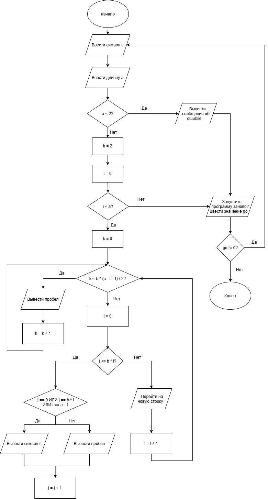

# Домашнее задание к работе 9

## Условие задачи

Написать программу, выводящую на экран геометрическую фигуру «Равнобедренный треугольник», нарисованную с помощью заданного с клавиатуры символа.

Предусмотреть возможность изменения размера фигуры путём задания её высоты пользователем.

Треугольник должен быть полым внутри, за исключением нижней строки, которая полностью заполняется заданным символом.

Обеспечить повторение выполнения программы в цикле do-while до тех пор, пока пользователь не захочет её завершить.

## 1. Алгоритм и блок-схема

### Алгоритм

1. Объявить переменные c типа char, a, b, i, j, k, go типа int.
2. Присвоить переменной b значение 2.
3. Запросить у пользователя символ (c).
4. Запросить у пользователя длину стороны равнобедренного треугольника (a).
5. Проверить высоту треугольника:
   - Если a < 2, вывести сообщение об ошибке.
   - Иначе перейти к построению треугольника.
6. Организовать внешний цикл for (i = 0; i < a; i++) для перебора строк треугольника.
7. Организовать внутренний цикл for (k = 0; k < b * (a - i - 1) / 2; k++) для вывода пробелов перед символами.
8. Организовать цикл for (j = 0; j <= b * i; j++) для построения треугольника.
9. Проверить условие j == 0 || j == b * i || i == a - 1:
   - Если условие выполняется, вывести символ c.
   - Иначе вывести пробел.
10. После завершения построения треугольника запросить у пользователя, нужно ли запустить программу заново.
11. Если цифра больше нуля — начать программу заново, меньше нуля — завершить программу.

## Блок-схема

---

## 2. Реализация программы
---

## 3. Результаты работы программы

---

Пример работы программы при вводе символа `#`, длины **8**:

Введите символ из которого будет состоять фигура: #

Введите длину стороны треугольника: 8

Равнобедренный треугольник:

       #
      # #
     #   #
    #     #
   #       #
  #         #
 #           #
###############

Запустить программу заново? (любая цифра - да; 0 - нет):

---

## 4. Информация о разработчике

- **ФИО:** Губский Данил Максимович
- **Группа:** бОТИ-261
